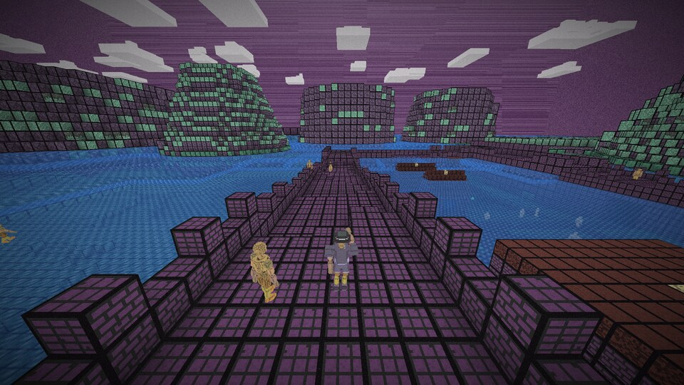

# ZOXEL

**A procedural voxel RPG about exploration, discovery, and the strange things beyond the known world.**

[](https://deus0.itch.io/zoxel)

[](https://github.com/SanderMertens/flecs)


[**Play**](#play) · [Explore](#the-world) · [Features](#features) · [Build](#build-from-source) · [Documentation](#documentation) · [Development](#development)



*The world is waiting.*

## The World

Mountains rise from ancient forests. Roads lead to walled towns. Dungeons lie beneath the earth, and strange creatures wander through the night.

You begin with very little. Beyond the horizon lies a procedurally generated world waiting to be explored, altered, and understood.

**The world is not a collection of levels. It is a place.**

### Features

| | |
| :--- | :--- |
| 🌍 **Procedural worlds** | Explore mountains, forests, lakes, caves, ruins, and vast wilderness. |
| 🧱 **Voxel terrain** | Shape the world around you. Gather resources and build something of your own. |
| 🏘️ **Towns & settlements** | Discover walled towns, homes, roads, and the characters who inhabit them. |
| ⚔️ **Combat & equipment** | Fight creatures, discover items, and equip your character. |
| ✨ **Character progression** | Develop skills, improve your stats, and shape your journey. |
| 📜 **Quests & dialogue** | Meet strange characters, take on quests, and discover what the world has hidden away. |
| 🎮 **Local co-op** | Explore together with split-screen multiplayer. |

## Play

Download the latest playable builds on itch.io.

[](https://deus0.itch.io/zoxel)

Zoxel is in active development. The world is still growing.

## Build from Source

Zoxel is free and open source software, released under the GPL and written in **C**, using the [Flecs](https://github.com/SanderMertens/flecs) Entity Component System and SDL.

```bash
git clone https://codeberg.org/deus/zoxel
cd zoxel
./bsh/flecs.sh
./bsh/build.sh
```

New to the project? Read the [onboarding guide](doc/onboarding.md) for build instructions, module structure, systems, tests, and picking up a development task.

## Documentation

The [documentation](doc) is a living reference for Zoxel's engine, modules, architecture, and development workflow.

| Guide | Contents |
| :--- | :--- |
| [**Onboarding**](doc/onboarding.md) | Start here. Project overview, building, module layout, systems, and tests. |
| [Engine](doc/engine/_.md) | Architecture, systems, spawning, commands, and tools. |
| [Technical documentation](doc/tech/_.md) | Characters, children, blocks, water, UIs, and other modules. |
| [Entity links](doc/engine/links.md) | `zox_link`, single and many links, and reacting to unlinks. |
| [Coding standards](doc/engine/coding_standards.md) | Code style and conventions. |
| [Tests](doc/engine/tests.md) | Writing and running tests. |

## Development

Follow the development of Zoxel, explore the source, and see how the world evolves.

[Codeberg](https://codeberg.org/deus/zoxel) · [Mastodon](https://mastodon.gamedev.place/@deus) · [Twitter / X](https://x.com/deusxyz) · [itch.io](https://deus0.itch.io/zoxel)

---

*The world is larger than the horizon.*

**Go find out what is beyond it.**
