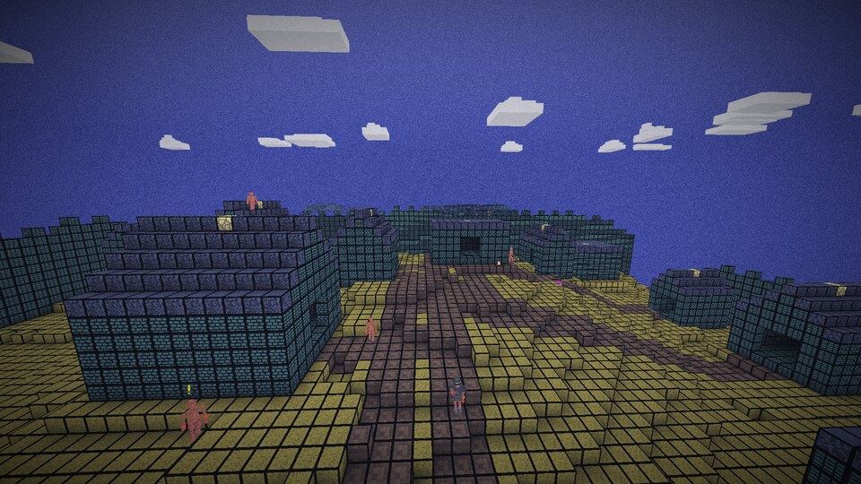

```text
    +--------+
   /        /|
  +--------+ |
  |  ZOXEL | +
  |        |/
  +--------+/

                 ~ the world is waiting ~
```
# Zoxel

A procedural voxel RPG about exploration, discovery, and the strange things
that exist beyond the edge of the known world.



The land is vast. Mountains rise from forests, villages appear in the
wilderness, dungeons lie beneath the earth, and creatures wander through the
night.

You begin with very little. Go see what is out there.


## Explore

Zoxel is built around one idea: **give the player a world worth getting lost in.**

Explore forests, mountains, caves, towns, ruins, and the wilderness between
them. Follow roads into unfamiliar territory, climb over mountains, descend
into the dark, and find something that was never marked on a map.

The world is generated procedurally, so there is always somewhere else to go.


## A World of Voxels

Everything begins with the world. Terrain is built from voxels, a landscape
that stretches far beyond what you can see, and you can change all of it.

Build. Explore. Fight. Gather. Travel.

The world is not a collection of levels. It is a place.


## Become Part of It

As you explore, your character grows. Find equipment, develop skills, improve
your stats, take on quests, meet strange characters, fight creatures, and
discover what the world has hidden away.

Your journey is yours to shape.


## What's Inside

- 🌲 Procedural voxel worlds
- 🏘️ Walled towns, homes, and roads
- ⛰️ Mountains, forests, lakes, caves, and wilderness
- ⚔️ Combat
- 🎒 Items and equipment
- 📈 Character stats and ✨ skills
- 📜 Quests, 🧙 characters, and dialogue
- 🎮 Split screen local co-op


## Play

The latest builds are on itch.io: https://deus0.itch.io/zoxel


## Build From Source

Zoxel is free and open source, released under the GPL. It's written in C with
[flecs](https://github.com/SanderMertens/flecs) (an ECS) and SDL, and is being
actively developed: the world is still growing.

```bash
git clone https://codeberg.org/deus/zoxel
cd zoxel
./bsh/flecs.sh
./bsh/build.sh
```

Source: https://codeberg.org/deus/zoxel


## Docs

Notes on how the code fits together live in [doc](doc). They're a work in
progress and will be reorganised over time.

New to the code? Start with **[Onboarding](doc/onboarding.md)**: the big
picture, building, the module layout, reading systems, tests, and how to pick
up a task.

- [Characters](doc/character.md): how characters are structured, their
  children (voxes, renderers, skeletons), and tips for working with them
- [Links](doc/links.md): pointing entities at each other with `zox_link`,
  single and many links, and reacting to unlinks
- [Children](doc/children.md): parenting, getting children, and ordered
  children
- [Commands](doc/commands.md): command line flags for the game binary
  (`--autostart`, `--tiny`, `--nosaves`, tests and more)
- [Architecture](doc/architecture.md): events vs systems, and other
  design guidelines
- [Coding Standards](doc/coding_standards.md): code style and conventions
- [Tests](doc/tests.md): writing and running tests


## Follow Development

- Mastodon: https://mastodon.gamedev.place/@deus
- Twitter: https://x.com/deusxyz

---

The world is larger than the horizon.

Go find out what is beyond it.

